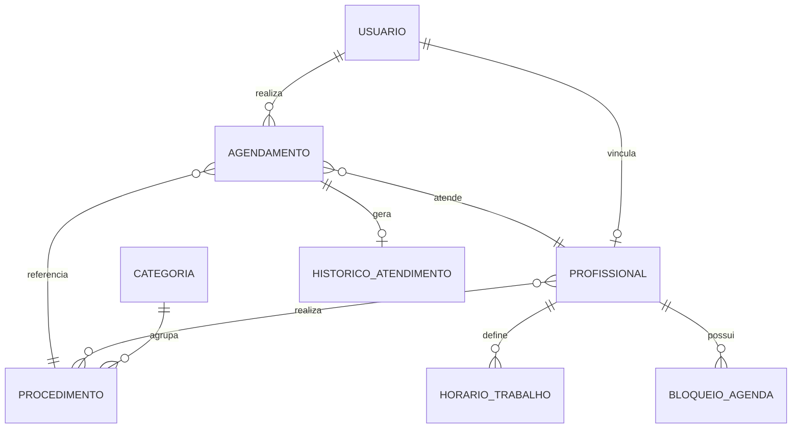

# 🌸 Sistema de Agendamento Online - Clínica de Estética (L'Élégance)

Sistema completo de agendamento online e gestão operacional para clínica de estética avançada, desenvolvido com foco em alta conversão no mobile, arquitetura limpa (Clean Architecture), tratamento rigoroso de concorrência e agendamento duplo (*double-booking*), e design refinado em tons nude, rosé suave e champagne.

---

## 🛠️ Stack Tecnológica

### Backend
- **Linguagem & Framework:** Java 17+, Spring Boot 3.2.x (Spring Web, Spring Data JPA, Spring Security com JWT, Bean Validation, Lombok).
- **Banco de Dados:** PostgreSQL (com suporte a fallback H2 Database).
- **Concorrência & Locks:** Optimistic Locking via `@Version` e queries de colisão em nível transacional.
- **Eventos & Agendamento:** Observer pattern com Spring `@Async` / `@EventListener` para notificações imediatas e `@Scheduled` (Cron) para lembretes pré-consulta.
- **Documentação:** OpenAPI 3 / Swagger UI (`/swagger-ui.html`).
- **Padrão de Erros:** RFC 7807 (*Problem Details*) via `@RestControllerAdvice`.

### Frontend
- **Framework:** Angular 21 (Standalone Components, Signals, Reactive Forms, Lazy Loading de rotas).
- **Design System:** Tailwind CSS customizado com paleta de luxo e estética (*nude, rosé gold, champagne*).
- **Mobile-First / PWA:** Bottom Navigation Bar dedicada para smartphones, layout adaptativo e touch-friendly.

---

## 🏗️ Modelo de Dados & Entidades Principais



1. **`Usuario` (`tb_usuario`)**: Identificação de clientes, especialistas e administradores (`ROLE_CLIENTE`, `ROLE_PROFISSIONAL`, `ROLE_ADMIN`).
2. **`Categoria` (`tb_categoria`)**: Categorias de procedimentos (Facial, Corporal, Massagens & Spa, Depilação a Laser).
3. **`Procedimento` (`tb_procedimento`)**: Procedimentos estéticos com duração (minutos), preço (R$), descrição e foto.
4. **`Profissional` (`tb_profissional`)**: Especialistas com foto, biografia, cor identificadora e procedimentos habilitados N:N.
5. **`HorarioTrabalho` (`tb_horario_trabalho`)**: Escala semanal por dia da semana (`DayOfWeek`), horário de entrada, saída e intervalo de almoço.
6. **`BloqueioAgenda` (`tb_bloqueio_agenda`)**: Folgas, férias ou bloqueios pontuais de agenda.
7. **`Agendamento` (`tb_agendamento`)**: Ciclo do agendamento com controle de versão `@Version`, horários de início/fim e status (`PENDENTE`, `CONFIRMADO`, `CONCLUIDO`, `CANCELADO`, `NO_SHOW`).
8. **`HistoricoAtendimento` (`tb_historico_atendimento`)**: Prontuário simplificado com anamnese clínica, reações adversas e orientações pós-procedimento.

---

## ⏱️ Algoritmo da Grade de Horários Livres (Disponibilidade em Tempo Real)

O `DisponibilidadeService` calcula os horários livres cruzando em tempo real:
1. **Duração do Procedimento:** Calcula os blocos no tamanho exato do serviço solicitado (ex: 45 min, 60 min).
2. **Jornada de Trabalho:** Consulta o `HorarioTrabalho` ativo do profissional para o dia da semana da data solicitada.
3. **Intervalos & Pausas:** Remove slots que colidem com horário de almoço ou descanso do especialista.
4. **Agendamentos Existentes:** Filtra qualquer horário já ocupado por agendamentos `CONFIRMADO` ou `PENDENTE` através da condição de colisão:
   $$\text{SlotInicio} < \text{AgendamentoFim} \quad \text{e} \quad \text{SlotFim} > \text{AgendamentoInicio}$$
5. **Bloqueios e Folgas:** Exclui slots coincidentes com períodos registrados em `BloqueioAgenda`.
6. **Margem para o Próprio Dia:** Não exibe slots passados ou com antecedência inferior a 30 minutos.
7. **Modo "Primeiro Horário Disponível":** Agrega e ordena cronologicamente as disponibilidades de todos os especialistas habilitados para aquele procedimento.

---

## 🚀 Como Executar o Projeto

### Opção 1: Via Docker Compose (Recomendada)
Para subir o banco PostgreSQL, backend Spring Boot e frontend Angular em contêineres:

```bash
cd D:\PROJETOS_GITHOUB\clinica-estetica
docker-compose up --build -d
```

- **Frontend Angular:** [http://localhost:4200](http://localhost:4200)
- **Backend API:** [http://localhost:8080](http://localhost:8080)
- **Swagger UI:** [http://localhost:8080/swagger-ui.html](http://localhost:8080/swagger-ui.html)

---

### Opção 2: Execução Local para Desenvolvimento

#### 1. Iniciar o Banco PostgreSQL
```bash
docker run --name estetica-postgres -e POSTGRES_DB=clinica_estetica -e POSTGRES_PASSWORD=postgres -p 5432:5432 -d postgres:16-alpine
```

#### 2. Iniciar o Backend (Spring Boot)
```bash
cd D:\PROJETOS_GITHOUB\clinica-estetica\estetica-api
mvn spring-boot:run
```

#### 3. Iniciar o Frontend (Angular)
```bash
cd D:\PROJETOS_GITHOUB\clinica-estetica\estetica-web
npm start
```
Acesse no seu navegador: [http://localhost:4200](http://localhost:4200).

---

## 🔑 Credenciais Pré-configuradas para Testes

O sistema roda o `DataInitializer` automaticamente na primeira inicialização, criando usuários e procedimentos:

| Perfil | E-mail | Senha | Funcionalidades |
| :--- | :--- | :--- | :--- |
| **Administrador** | `admin@clinicaestetica.com` | `admin123` | Dashboard geral, Agenda clínica, Prontuários e troca de status |
| **Especialista** | `camila@clinicaestetica.com` | `prof123` | Visualização de agenda e prontuários |
| **Cliente VIP** | `cliente@exemplo.com` | `cliente123` | Agendamento online, histórico e cancelamento/remarcação |

